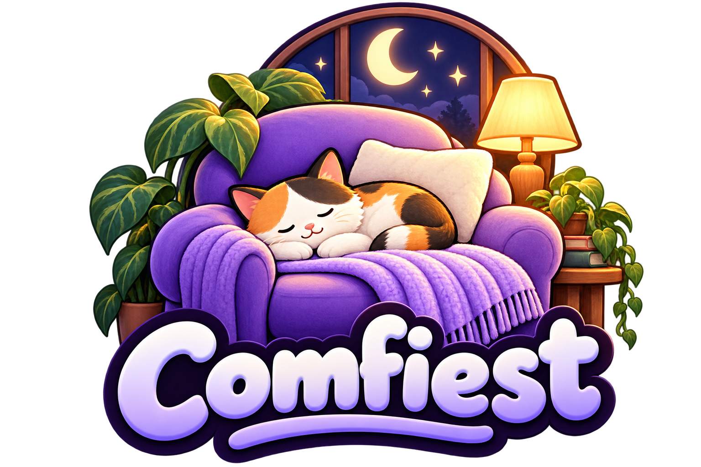

<p align="center">
  
</p>

<h1 align="center">Comfiest</h1>

<p align="center">
  <strong>com·fi·est</strong> <em>adjective</em><br>
  <em>informal</em> : the superlative form of <strong>comfy</strong><br>
  <strong>comfy</strong> <em>noun</em> : ComfyUI
</p>

<p align="center">
  <strong>A local-first, open-weights video production suite for ComfyUI — driven by your agent.</strong>
</p>

<p align="center">
  <a href="#start-here-point-your-agent-at-the-repo">Start here</a> ·
  <a href="#quick-start">Quick start</a> ·
  <a href="#workflow-catalog">Workflows</a> ·
  <a href="#requirements">Requirements</a> ·
  <a href="#contributing">Contributing</a>
</p>

---

Comfiest packages the parts of an AI production pipeline that normally live in someone's head:
model routing, workflow templates, hardware limits, submission loops, output provenance, and the
small traps that waste a render. Point a coding agent at this repository and it can set up the MCP
bridge, pick the right model for a shot, run it, and collect the result.

Built for the [Comfy Org Open Source Higgsfield](https://comfy.org/open-source-higgsfield) challenge.

| Create | Models and capabilities |
| --- | --- |
| **Images from text** | Krea 2 Turbo, Flux.2 Klein 9B |
| **Image edits** | Krea 2 Edit, Flux.2 Klein 9B reference edit |
| **Speech** | Fish Audio Drama 3 — single/dual speaker, voice clone |
| **Music** | YuE2 3B, MiniMax Music 3 |
| **Video from text or references** | MiniMax H3 — text-to-video, 1–2 pictures, video/audio references, forced lip-sync, character swap |

**No partner nodes. No API keys. No credits.** Everything runs on your own ComfyUI with open weights.

---

## Start here: point your agent at the repo

The primary interface is an agent. Open this repository in Claude Code, OpenCode, Codex, Cursor, or
any client with MCP support, and say:

> **“Set up Comfiest for my ComfyUI server, then run the fox demo and show me the output.”**

The agent should:

1. Read [`README.md`](README.md), [`COMFY-SETUP.md`](COMFY-SETUP.md), and [`skills/SKILL.md`](skills/SKILL.md).
2. If ComfyUI is not installed, follow [`COMFY-SETUP.md`](COMFY-SETUP.md) to install ComfyUI, the node packs, and the models.
3. Install/register the `comfy-*` MCP server for your ComfyUI host using [`MCP-SETUP.md`](MCP-SETUP.md).
4. Confirm the target with `server_info()` and `/system_stats`.
5. Pick a workflow from the routing table and submit it with `run_workflow`.
6. Collect the output into `work/outputs/<project>/<date>/<prompt_id>/` and verify its size.

### Add the skills to your agent

If your agent supports skills:

- Copy `skills/SKILL.md` to `<client-skills>/comfiest/SKILL.md` for the umbrella rules and routing.
- Copy `skills/minimaxh3/`, `skills/minimaxh3-character-replace/`, and `skills/fish-audio-drama3/`
  as sibling skill directories if your client discovers each skill separately.

The umbrella carries the hard rules and routing; the subskills carry family and recipe detail.

## What your agent gets

- **Routing that respects hardware.** Krea/Flux for images, YuE2/Music 3 for songs, Drama 3 for
  speech, MiniMax H3 for video. Heavy models are called out before they blow up a 24 GB card.
- **Workflow templates that actually run.** UI files for ComfyUI, pre-slimmed `api/*.api.json`
  mirrors for MCP execution, and conversion notes for the frontend-only nodes that break API runs.
- **A submission loop that survives real life.** `wait: false` + `/history` polling, direct output
  URL fallback when local job state lags, one-job-per-target discipline.
- **Provenance by default.** Every file lands under a `prompt_id` folder with a run-log entry; vision
  QA is allowed only on your own outputs.
- **A writable workspace.** `work/` is the only place agents create files; the shipped workflows stay
  intact.

## Quick start

### 1. Set up ComfyUI

Install ComfyUI 0.42 or newer with the node packs and models listed in
[`skills/SKILL.md`](skills/SKILL.md#target-requirements). A 24 GB-class GPU is the baseline. Drama 3
loads 38.6 GB of experts into system RAM; use a high-RAM host.

For a complete, copy-pasteable install — ComfyUI, all 18 custom-node packs, every model, and the
TensorRT depth engine — follow [`COMFY-SETUP.md`](COMFY-SETUP.md). It includes two scripts:

```bash
python scripts/install_nodes.py --comfyui "$COMFYUI"
python scripts/download_models.py --comfyui "$COMFYUI"
```

### 2. Connect the MCP bridge

Comfiest talks to ComfyUI through [`comfy-mcp`](https://github.com/Comfy-Org/comfy-mcp), a thin stdio
server around `comfy-cli`.

```bash
# macOS / Linux
python -m venv ~/venvs/comfiest
~/venvs/comfiest/bin/pip install comfy-cli comfy-mcp
```

```powershell
# Windows PowerShell
python -m venv $env:USERPROFILE\venvs\comfiest
& "$env:USERPROFILE\venvs\comfiest\Scripts\pip" install comfy-cli comfy-mcp
```

Then register one server per ComfyUI target. Full instructions, environment variables, and client
snippets for OpenCode, Claude Code/Desktop, Codex, Cursor, Hermes, and a generic stdio client are in
[`MCP-SETUP.md`](MCP-SETUP.md).

### 3. Run your first workflow

Ask the agent for the fox demo, or submit directly:

```js
const run = await tools["comfy-<host>-<port>"].run_workflow({
  workflow_path: "<repo>/workflows/text2image-krea.json",
  wait: false
});
await tools["comfy-<host>-<port>"].job({ action: "wait", prompt_id: run.prompt_id });
await tools["comfy-<host>-<port>"].fetch_outputs({
  prompt_id: run.prompt_id,
  out_dir: "<repo>/work/outputs/fox-demo/<date>/" + run.prompt_id
});
```

Replace `<repo>` with the absolute path to this repository on the MCP host, and `<host>`/`<port>` with
one of your registered servers.

## Demo inputs

The demo prompts are self-contained, but the reference-driven workflows expect files on the ComfyUI
host:

| Workflow | Expected input | How to supply it |
| --- | --- | --- |
| Krea / Flux edit | `example.png` | Stage in `work/uploads/<project>/`, upload with `upload_file`. |
| Drama 3 clone variants | `example.wav` | Upload clean single-speaker clips and replace the transcript placeholders to match. |
| MiniMax H3 reference variants | `example.png`, `example.mp4`, `example.wav` | Upload the slots the variant uses; every image slot uses the same placeholder. |

> **Voice-clone inputs:** The transcripts in the TTS templates are placeholders (“The quick brown
> fox…”). A clone only works when the transcript matches the clip word for word, so replace both.

## Workflow catalog

| Task | Model | Workflow | Notes |
| --- | --- | --- | --- |
| Photoreal text → image | Krea 2 Turbo | [Text to image](workflows/text2image-krea.json) | 1024×1280, 14 steps, no LoRA |
| Identity-preserving edit | Krea 2 Edit | [Image edit](workflows/image2image-krea-edit.json) | reference image + instruction |
| Stylized text → image | Flux.2 Klein 9B | [Text to image](workflows/text2image-fluxklein.json) | 4-step RES4LYF |
| Reference edit | Flux.2 Klein 9B | [Reference edit](workflows/image2image-fluxklein.json) | source-size canvas |
| Song from style + lyrics | YuE2 3B | [Style + lyrics](workflows/text2music-yue2.json) | 120 s, vocals |
| Song from caption + lyrics | MiniMax Music 3 | [Caption + lyrics](workflows/text2music-minimaxmusic3.json) | tiled audio decode |
| Speech / voice clone | Fish Audio Drama 3 | [Speech workflows](workflows/fishdrama3/) | 4 variants, 1–2 speakers |
| Video + audio | MiniMax H3 | [Video workflows](workflows/minimaxh3/) | 14 variants + 3 char-replace workflows |

MiniMax H3 is the video workhorse: text-to-video, 1–2 picture references, video/audio references,
forced-audio lip-sync, and character replacement. See
[`skills/minimaxh3/SKILL.md`](skills/minimaxh3/SKILL.md) for the variant matrix and
[`minimaxh3-character-replace`](skills/minimaxh3-character-replace/SKILL.md) for the swap pipeline.

## Repository layout

```text
.
├── README.md                # this file
├── LICENSE                  # MIT (repository); model weights keep their upstream licenses
├── COMFY-SETUP.md           # install ComfyUI, nodes, models, TensorRT engine
├── MCP-SETUP.md             # install, register, verify comfy-mcp
├── assets/
│   └── logo.png             # project logo
├── skills/
│   ├── SKILL.md             # umbrella: rules, routing, operating loop
│   ├── minimaxh3/SKILL.md   # H3 variant matrix and execution notes
│   ├── minimaxh3-character-replace/SKILL.md
│   └── fish-audio-drama3/SKILL.md
├── scripts/
│   ├── install_nodes.py     # clone/update custom nodes, pip requirements
│   └── download_models.py   # Hugging Face downloads into ComfyUI folders
├── workflows/               # 43 workflow templates
│   ├── *.json
│   ├── fishdrama3/          # TTS base + variants
│   └── minimaxh3/           # H3 base, UI variants, api/ mirrors
└── work/                    # writable agent workspace (not required to run)
    ├── inbox/  scratch/  uploads/  outputs/
    ├── analysis/  post/  exports/  logs/
    └── README.md
```

## Design principles

1. **Open weights only.** Every workflow is a local ComfyUI graph. No partner/cloud nodes, no API
   keys, no credits.
2. **Agent-native.** The skill is written for a machine reader: explicit rules, exact filenames, node
   IDs, known failure modes, and a provenance contract.
3. **Templates, not lock-in.** Copy a workflow to `work/scratch/`, change it, run it. The shipped
   graphs are a starting point.
4. **One job per target.** Parallel work only across different ComfyUI hosts.
5. **Provenance over vibes.** A `prompt_id`, a run-log row, and a non-zero file size prove a run
   happened. Vision is QA, not verification.

## Public-release sanitization

This repository is the sanitized public edition of a working production suite:

- Non-turbo LoRAs (character, style, anatomy, adult-oriented) were removed. Only the MiniMax H3
  `lightx2v`-family turbo LoRA remains, plus the model-native distilled samplers.
- Every baked-in prompt was replaced with a fox-themed demo prompt. Reference audio/image names were
  genericized.
- UI workflows were conversion-validated against a live ComfyUI target; the sanitized graphs have not
  been executed end-to-end. Run one job before relying on a template in production.

Add your own LoRAs and prompts in `work/scratch/`. If a look needs a custom LoRA, document it in your
fork rather than editing the shipped template.

## Requirements

- ComfyUI 0.42+ and frontend 1.57.1+.
- `comfy-cli` + `comfy-mcp` (Python 3.12 tested).
- Node packs: the full set is installed by [`COMFY-SETUP.md`](COMFY-SETUP.md) — rgthree, GGUF,
  RES4LYF, WAS, Easy-Use, various, KJNodes, VideoHelperSuite, Drama3, krea2edit, Conditioning
  Rebalance, PlagueKind, Fill-Nodes, Spectrum, Impact Pack, SAM3, and Depth-Anything-TensorRT.
  Frame-Interpolation is optional (the H3 graphs use Fill-Nodes `FL_RIFE`).
- Models: Krea 2 Turbo/Edit, Flux.2 Klein 9B + Qwen3-8B GGUF, YuE2 3B, MiniMax Music 3, Fish Audio
  Drama 3, MiniMax H3 fastvideo stack. Exact filenames live in the workflow sections of
  [`skills/SKILL.md`](skills/SKILL.md); verify each host with `/models/<folder>` and `/object_info`.
  The full download list, Hugging Face locations, and folder layout are in
  [`COMFY-SETUP.md`](COMFY-SETUP.md).
- GPU: 24 GB-class for video and Drama 3; 128 GB+ system RAM recommended for Drama 3.

Model weights are not distributed here. Download them from their upstream publishers and follow their
licenses.

## Contributing

Issues and PRs are welcome, especially new workflows, node-pack compatibility fixes, and agent
ergonomics.

- Keep workflows runnable: include both the UI file and, where useful, an API mirror under
  `workflows/<family>/api/`.
- Update `skills/SKILL.md` and the family README with inputs, settings, save prefix, and known traps.
- Run `comfy run --workflow <file> --print-prompt --host <host> --port <port>` before submitting.
- Never commit `work/` contents, model weights, generated outputs, or credentials.

## License

Repository code and documentation: [MIT](LICENSE).

Workflow JSON is provided under the same MIT terms. Model weights, LoRAs, and node packs remain under
their own upstream licenses — check each model card before commercial use. “Comfiest” is not
affiliated with Comfy Org, Krea, Black Forest Labs, MiniMax, Fish Audio, or YuE2.

## Acknowledgments

ComfyUI and `comfy-mcp` by Comfy Org; Krea 2, Flux.2 Klein, YuE2, MiniMax H3/Music 3, and Fish Audio
Drama 3 by their respective teams; rgthree, RES4LYF, KJNodes, VideoHelperSuite, Frame Interpolation,
and the other node-pack authors who make these graphs possible.
